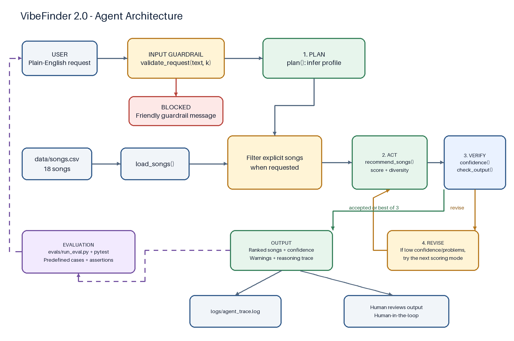
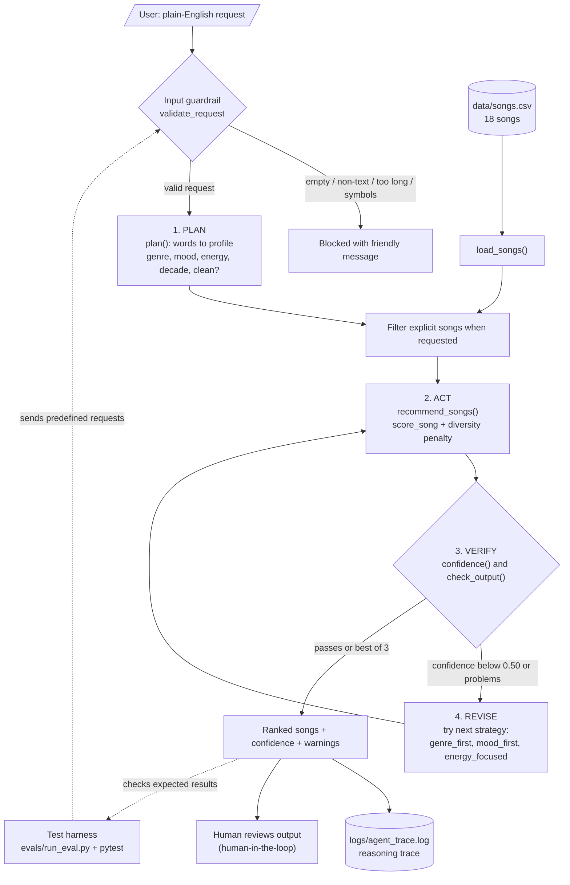

# VibeFinder 2.0

## Title and Summary

VibeFinder turns a plain-English music request into a ranked list from a small song catalog. Its rule-based agent plans a taste profile, tries recommendation strategies, checks confidence and output guardrails, and revises when results are weak. It also explains its steps through a trace log and flags requests it does not understand well. This project shows how transparent rules can help while also exposing the limits of small datasets and heuristic confidence.

## Base Project

The base project is **Music Recommender Simulation (Module 3)**. It scored 18 songs against a hand-written taste profile using genre, mood, energy, and extra musical features, and explained each score. It includes three scoring modes and a diversity penalty to reduce repeated artists and genres.

## What Is New

- A plan/act/verify/revise agent loop with three scoring strategies.
- Input and output guardrails, including request-length limits and clean-music filtering.
- A confidence heuristic that combines score fit with how much of the request was recognized.
- Reasoning traces printed by the CLI and saved in `logs/agent_trace.log`.
- A ten-case evaluation harness and expanded pytest coverage.

## Architecture Overview





The CLI loads the CSV catalog and validates a user's request before planning begins.
The planner maps recognized words to genre, mood, energy, decade, and content preferences.
The agent filters explicit songs when requested, then scores and diversifies recommendations.
Verification checks confidence and result problems; revision tries the remaining scoring modes.
The best passing result—or best of three—is returned with warnings and a trace.
The trace is logged, and a person remains responsible for reviewing recommendations.

The Mermaid source is [architecture.mmd](diagrams/architecture.mmd).

## Setup Instructions

From the project root:

```bash
python -m venv .venv
source .venv/bin/activate
pip install -r requirements.txt
```

Run the original recommender, the natural-language CLI, the unit tests, or the evaluation harness:

```bash
python -m src.main
python -m src.agent_cli "I need chill music to study at night"
python -m pytest -q
python -m evals.run_eval
```

The agent CLI accepts a request as its command-line arguments and writes successful-run trace lines to `logs/agent_trace.log`.

## Sample Interactions

### Study request

```text
$ python -m src.agent_cli "I need chill music to study at night"
Request: I need chill music to study at night
Strategy used: mood_first | Confidence: 0.51
| Rank   | Title              | Artist         | Score   |
|--------|--------------------|----------------|---------|
| 1      | Midnight Coding    | LoRoom         | 5.00    |
| 2      | Spacewalk Thoughts | Orbit Bloom    | 4.98    |
| 3      | Library Rain       | Paper Lanterns | 4.04    |
| 4      | Night Drive Loop   | Neon Echo      | 1.73    |
| 5      | Rooftop Lights     | Indigo Parade  | 1.67    |

Agent trace:
 INPUT guardrail passed: 'I need chill music to study at night'
 PLAN profile = {'genre': None, 'mood': 'chill', 'energy': 0.3, 'target_popularity': 60, 'preferred_decade': 2020, 'preferred_mood_tags': ['chill'], 'target_instrumentalness': 0.3, 'exclude_explicit': False}
 ACT attempt 1 mode=genre_first: top='Midnight Coding' confidence=0.31 problems=none
 REVISE confidence 0.31 too low or problems found -> trying next strategy
 ACT attempt 2 mode=mood_first: top='Midnight Coding' confidence=0.51 problems=none
 VERIFY attempt 2 accepted (confidence >= 0.5)
```

### Clean pop request

```text
$ python -m src.agent_cli "clean pop party music"
Request: clean pop party music
Strategy used: genre_first | Confidence: 0.56
| Rank   | Title           | Artist            | Score   |
|--------|-----------------|-------------------|---------|
| 1      | Gym Hero        | Max Pulse         | 5.04    |
| 2      | Sunrise City    | Neon Echo         | 4.53    |
| 3      | Neon Parade     | The Brass Circuit | 2.07    |
| 4      | Rooftop Lights  | Indigo Parade     | 1.99    |
| 5      | Midnight Coding | LoRoom            | 1.64    |

Agent trace:
 INPUT guardrail passed: 'clean pop party music'
 PLAN profile = {'genre': 'pop', 'mood': None, 'energy': 0.9, 'target_popularity': 60, 'preferred_decade': 2020, 'preferred_mood_tags': [], 'target_instrumentalness': 0.3, 'exclude_explicit': True}
 GUARD clean-music request: removed 3 explicit songs
 ACT attempt 1 mode=genre_first: top='Gym Hero' confidence=0.56 problems=none
 VERIFY attempt 1 accepted (confidence >= 0.5)
```

### Unknown request

```text
$ python -m src.agent_cli "polka"
Request: polka
Strategy used: energy_focused | Confidence: 0.29
| Rank   | Title             | Artist       | Score   |
|--------|-------------------|--------------|---------|
| 1      | Midnight Coding   | LoRoom       | 3.88    |
| 2      | Island Lanterns   | Coral Avenue | 3.67    |
| 3      | Blue Hour Train   | Ellis Monroe | 3.56    |
| 4      | Night Drive Loop  | Neon Echo    | 3.43    |
| 5      | Backroad Postcard | June Wilder  | 3.43    |
WARNING: No genre or mood recognised; ranking by energy and other features only.
WARNING: Low confidence (0.29); showing the best of 3 strategies.

Agent trace:
 INPUT guardrail passed: 'polka'
 PLAN profile = {'genre': None, 'mood': None, 'energy': 0.5, 'target_popularity': 60, 'preferred_decade': 2020, 'preferred_mood_tags': [], 'target_instrumentalness': 0.3, 'exclude_explicit': False}
 ACT attempt 1 mode=genre_first: top='Midnight Coding' confidence=0.13 problems=none
 REVISE confidence 0.13 too low or problems found -> trying next strategy
 ACT attempt 2 mode=mood_first: top='Midnight Coding' confidence=0.13 problems=none
 REVISE confidence 0.13 too low or problems found -> trying next strategy
 ACT attempt 3 mode=energy_focused: top='Midnight Coding' confidence=0.29 problems=none
 REVISE confidence 0.29 too low or problems found -> trying next strategy
 VERIFY no attempt passed; using best (mode=energy_focused, confidence=0.29)
```

## Reliability and Guardrails

The input guardrail rejects non-text, blank, symbol-only, and over-300-character requests, as well as `k` outside 1–10. The output guardrail reports an empty or short recommendation list and artist dominance. A clean-music request excludes songs marked explicit; this is a catalog filter, not a general content-safety system.

An empty request is blocked before planning:

```text
$ python -m src.agent_cli ""
Guardrail blocked this request: Request is empty. Try: 'chill lofi music to study'.
Exit status: 1
```

Evaluation harness output from `python -m evals.run_eval`:

```text
| Test                                    | Detail                         | Result   |
|-----------------------------------------|--------------------------------|----------|
| Pop workout -> a pop song first         | conf=0.56, mode=genre_first    | PASS     |
| Study request -> a lofi song first      | conf=0.88, mode=genre_first    | PASS     |
| Rock request -> a rock song first       | conf=0.92, mode=genre_first    | PASS     |
| Clean request -> zero explicit songs    | conf=0.56, mode=genre_first    | PASS     |
| Unknown mood 'sad' -> warns the user    | conf=0.52, mode=genre_first    | PASS     |
| Gibberish -> low confidence + warning   | conf=0.29, mode=energy_focused | PASS     |
| Vague request -> agent revises strategy | conf=0.51, mode=mood_first     | PASS     |
| Empty input -> blocked by guardrail     | blocked                        | PASS     |
| Symbols only -> blocked by guardrail    | blocked                        | PASS     |
| Very long input -> blocked by guardrail | blocked                        | PASS     |

10/10 checks passed; average confidence on answered requests = 0.61
```

## Design Decisions

### Algorithm Recipe

The recommender offers three strategies: `genre_first` weights genre/mood/energy at 3/1/1; `mood_first` at 1/3/1; and `energy_focused` at 0.5/0.5/3. It adds up to 0.5 for popularity closeness, 0.5 for an exact release-decade match, up to 1.0 for overlapping mood tags, and up to 0.3 for instrumentalness closeness. Greedy diversity selection applies a 1-point repeat-artist and 0.5-point repeat-genre penalty for each previously selected match.

### Agent and confidence

The planner is rule-based and deliberately inspectable: a small keyword map turns requests into the feature values the scorer already understands. Confidence is the top recommendation's score divided by the best possible score, capped at 1, multiplied by an understanding factor based on recognized catalog genre and mood. The denominator counts genre and mood even when omitted, preventing vague requests from appearing confident merely because those categories were ignored.

The 0.50 threshold is a practical revision trigger, not a statistically calibrated boundary. The agent tries each scoring mode until confidence meets the threshold and output checks pass; otherwise it returns the best of three with a warning. A low threshold can stop too early, while a high threshold causes repeated revisions and can issue warnings even when results are usable. The system favors explainability and a human-readable trace over broad language understanding or learned personalization.

## Testing Summary

All **29 pytest tests** pass. The evaluation harness passes **10/10 checks**, with **0.61 average confidence** on answered requests. The weakest case is an unrecognized, genre-free request such as “polka”: it receives a low-confidence warning and still gets a best-effort list. The four controlled reliability experiments and their observed outcomes are recorded in [model_card.md](model_card.md).

## Reflection

The project made it clear that a precise-looking confidence number is only as trustworthy as its assumptions. The traces and controlled experiments helped distinguish “the scorer found a strong match” from “the planner understood what was asked.” The detailed reflection and limitations are in the [model card](model_card.md).

## Loom link (optional)

<!-- Add a project demo link here if one is recorded. -->
